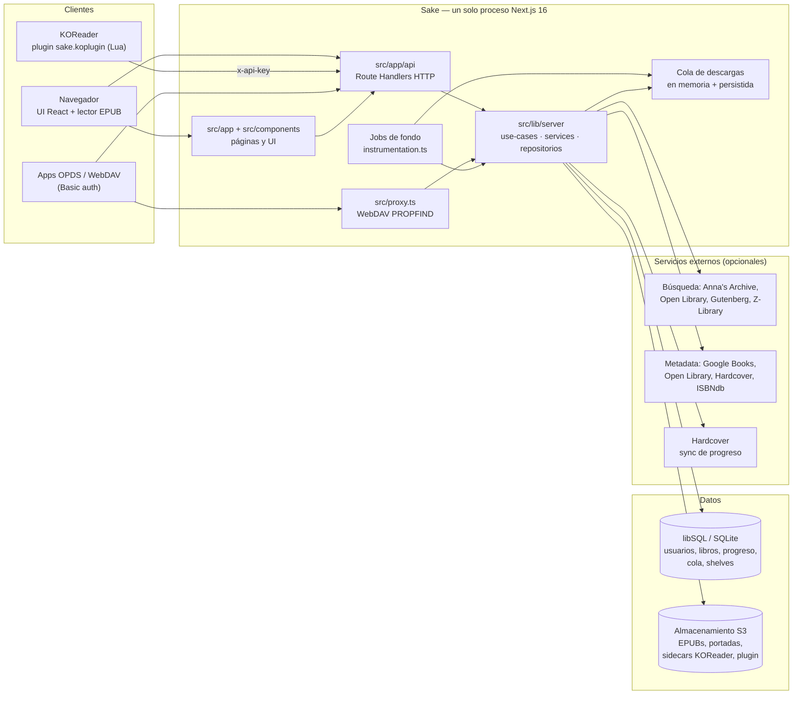
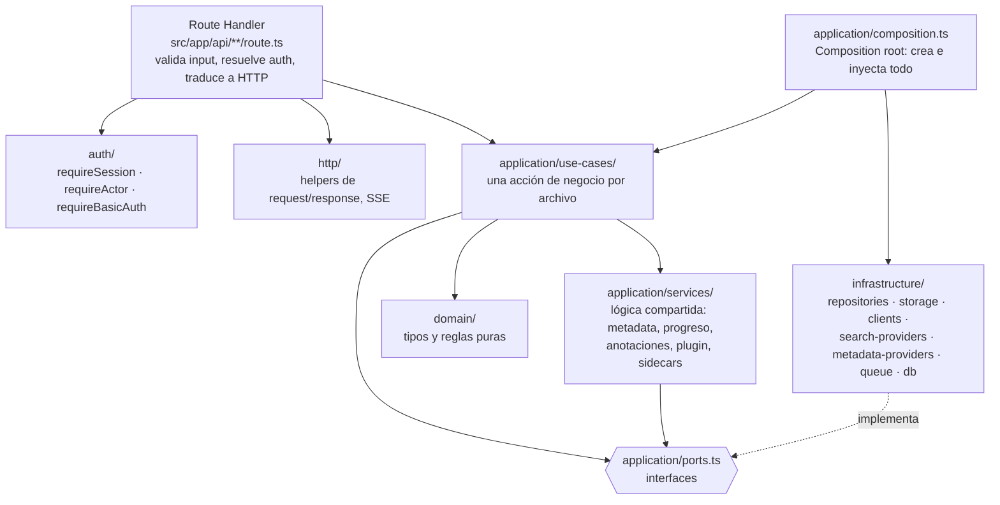
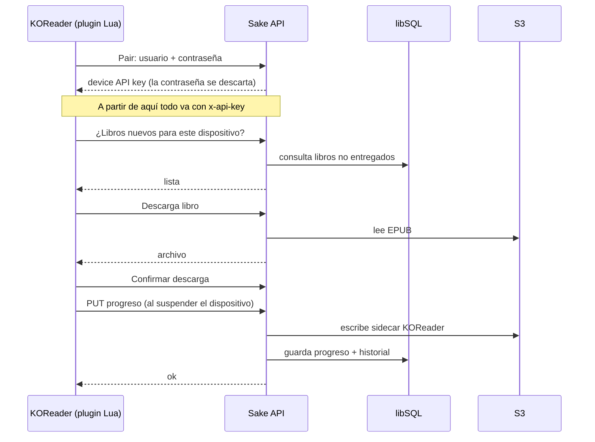
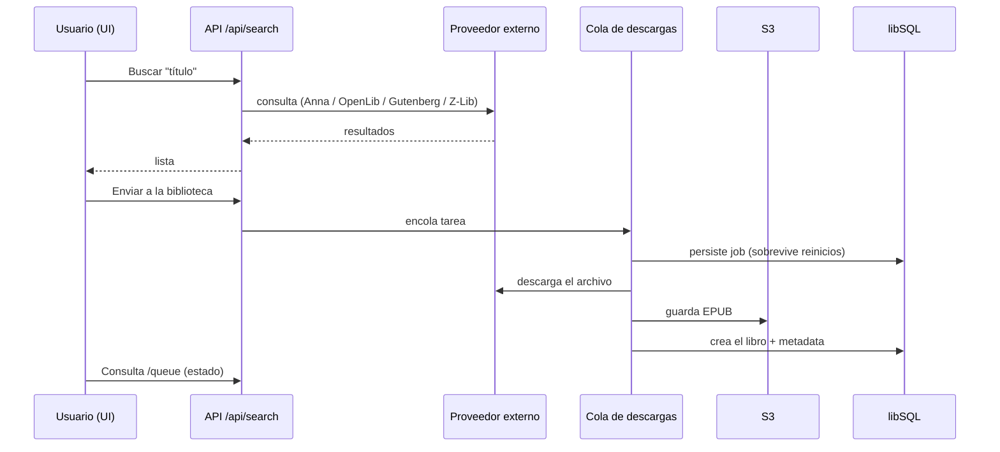
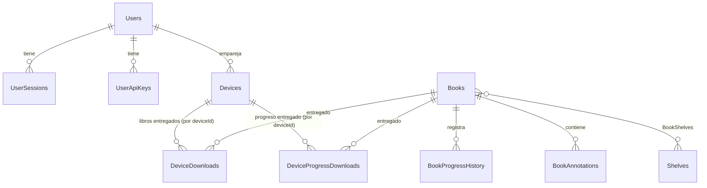
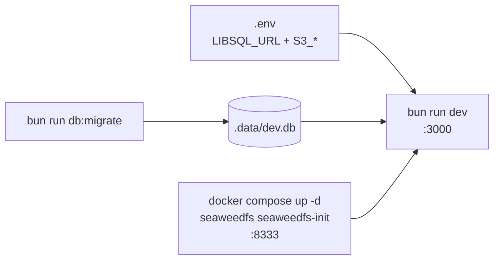
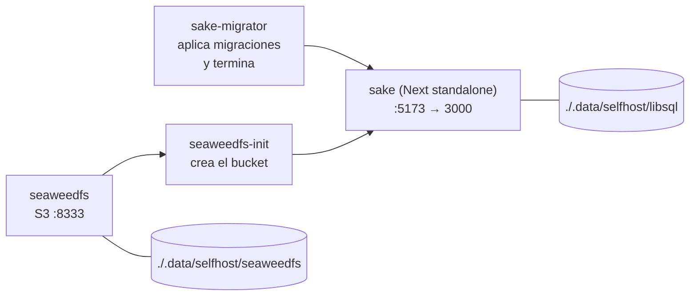

# Arquitectura de Sake

Mapa para quien llega al proyecto: qué piezas hay, qué hace cada una, cómo se comunican y cómo se levantan. Los diagramas son [Mermaid](https://mermaid.js.org/): GitHub y VS Code (con la extensión *Markdown Preview Mermaid Support*) los dibujan directamente.

Documentos relacionados: [README](../README.md) (instalación y variables), [DEVELOPMENT.md](DEVELOPMENT.md) (entorno local, base de datos, acceso), [CONTRIBUTING.md](../CONTRIBUTING.md) (convenciones).

## 1. Qué es Sake, en una frase

Una biblioteca de libros **self-hosted** (web + API) que sincroniza libros, progreso de lectura y anotaciones con lectores **KOReader** mediante un plugin Lua.

## 2. Vista general



Puntos clave:

- **Es un monolito.** Frontend, API y jobs de fondo corren en el mismo proceso Next.js. No hay un backend separado.
- **Dos almacenes con roles distintos:** la base de datos (libSQL) guarda lo relacional; S3 guarda los archivos (libros, portadas, sidecars de KOReader, el plugin).
- **Todo lo externo es opcional** y se activa por variables de entorno (`ACTIVATED_PROVIDERS`, `ACTIVATED_METADATA_PROVIDERS`).

## 3. Tecnologías y para qué sirve cada una

| Tecnología | Rol en Sake | Dónde mirar |
|---|---|---|
| **Next.js 16** (App Router) + **React 19** | UI y API en un solo proceso. Ojo: tiene cambios incompatibles con versiones anteriores (p. ej. `proxy.ts` en lugar de `middleware.ts`); ver [AGENTS.md](../AGENTS.md) | `src/app` |
| **TypeScript** | Todo el código web | — |
| **Bun** | Gestor de paquetes y runner de scripts (`bun install`, `bun run …`) | `package.json`, `bun.lock` |
| **Tailwind 4**, **shadcn/ui**, **base-ui** | Estilos y componentes | `src/components`, `components.json` |
| **libSQL** (SQLite compatible, o Turso) | Base de datos | `LIBSQL_URL` |
| **Drizzle ORM / drizzle-kit** | Esquema tipado y migraciones SQL | `src/lib/server/infrastructure/db/schema.ts`, `drizzle/` |
| **S3 compatible** (SeaweedFS, MinIO, R2, AWS) | Archivos. SeaweedFS es el que trae `docker-compose` | `S3_*`, `infrastructure/storage/s3-storage.ts` |
| **epub.js** | Lector EPUB en el navegador | `src/components/reader`, `src/lib/reader` |
| **Lua** (KOReader) | Plugin del e-reader; habla con la API por HTTP | `koreaderPlugins/` |
| **pino** | Logs (JSON en producción) | `infrastructure/logging` |
| **Docker** | Imagen `runtime` (app) e imagen `migrator` (migraciones) | `Dockerfile`, `docker-compose.yaml` |

## 4. Estructura del código

```
koreaderPlugins/
  sake.koplugin/         Plugin Lua para KOReader (sync de progreso, libros, logs)
  sakeUpdater.koplugin/  Actualizador del plugin
drizzle/                 Migraciones SQL generadas (se suben a git)
docs/                    Documentación y capturas
src/
  instrumentation.ts     Arranca los jobs de fondo al iniciar el servidor
  proxy.ts               Entrada de WebDAV (PROPFIND)
  app/
    (auth)/              Login / creación de la primera cuenta
    (app)/               Shell de la app: library, search, queue, stats, annotations, logs…
    (reader)/            Lector EPUB a pantalla completa
    api/                 API HTTP (ver §6)
  components/            UI organizada por feature
  lib/
    client/              Clientes tipados que la UI usa para llamar a /api
    reader/              Runtime del lector, paginación, RSVP, preferencias
    koreader/            Parser y serializador de sidecars (Lua) de KOReader
    server/              Backend, ver §5
```

## 5. Backend: capas (`src/lib/server`)

Sigue una arquitectura por capas con dependencias hacia adentro: las rutas llaman a casos de uso, los casos de uso dependen de **interfaces** (`ports.ts`), y la infraestructura implementa esas interfaces.



| Carpeta | Qué contiene |
|---|---|
| `application/use-cases/` | Una operación por archivo (`download-book.ts`, `create-shelf.ts`, `get-progress.ts`…). Es lo primero que hay que leer para entender una feature. |
| `application/services/` | Lógica compartida entre casos de uso (agregador de metadata, persistencia de progreso, índice de anotaciones, sincronización del plugin). |
| `application/ports.ts` | Interfaces (`*RepositoryPort`, etc.) que desacoplan negocio de infraestructura. |
| `application/composition.ts` | **Composition root**: instancia repositorios, servicios y casos de uso y los exporta. Cuando agregues una feature, regístrala aquí. |
| `domain/` | Tipos y reglas sin dependencias externas. |
| `infrastructure/` | Implementaciones: repositorios Drizzle, cliente S3, proveedores de búsqueda y metadata, cola de descargas, logging. |
| `auth/` | Autenticación por ruta (ver §7). |
| `jobs/` | Jobs de fondo. |
| `opds/`, `dav/` | Catálogo OPDS y WebDAV. |

> Los comentarios "Fase 3x" en `composition.ts` son historial de la migración desde SvelteKit (ver [MIGRATION_HANDOFF.md](../MIGRATION_HANDOFF.md)); todas las fases ya están portadas.

## 6. API HTTP (`src/app/api`)

| Grupo | Para qué |
|---|---|
| `auth/` | Bootstrap de la primera cuenta, login/logout, API keys, device-key (emparejar KOReader), contraseña Basic |
| `library/` | Libros: listar, detalle, contenido, portada, metadata, rating, progreso, descargas, papelera/archivo, shelves |
| `search/`, `zlibrary/` | Búsqueda en proveedores y login de Z-Library |
| `metadata/` | Búsqueda de candidatos de metadata |
| `queue/` | Estado de la cola de descargas |
| `annotations/` | Hub de anotaciones: listar, editar, exportar, reindexar |
| `devices/` | Dispositivos KOReader, versiones y logs remotos (SSE) |
| `plugin/` | Releases del plugin KOReader |
| `integrations/` | Hardcover, mirrors de Z-Library |
| `opds/` | Catálogo OPDS |
| `stats/`, `app/` | Estadísticas de lectura, versión de la app |

## 7. Autenticación

Se resuelve **en cada ruta**, no en un middleware global:

| Función | Quién la usa | Credencial |
|---|---|---|
| `requireSession()` | UI web | Cookie de sesión |
| `requireActor()` | Rutas que también usa KOReader | Cookie **o** header `x-api-key` (clave del dispositivo) |
| `requireBasicAuth()` | OPDS y WebDAV | HTTP Basic (contraseña de la cuenta o contraseña Basic propia) |

No hay registro abierto: la **primera** cuenta se crea con `/api/auth/bootstrap` y luego se cierra (pensado para una instancia de un solo dueño). Detalles en [DEVELOPMENT.md](DEVELOPMENT.md#3-usuarios-y-acceso).

## 8. Flujos principales

### 8.1 Sincronizar un e-reader KOReader



El lector web guarda el progreso en el **mismo formato** que KOReader, por eso ambos se pueden alternar sobre el mismo libro.

### 8.2 Buscar y descargar un libro



### 8.3 Jobs de fondo

Arrancan una vez desde `src/instrumentation.ts` → `jobs/background-jobs.ts`:

- **Purga de papelera** cada 6 h (`SAKE_SKIP_TRASH_PURGE` la desactiva).
- **Sincronización del plugin KOReader** al arrancar: sube `koreaderPlugins/sake.koplugin` a S3 para que los dispositivos puedan actualizarse (`SAKE_SKIP_STARTUP_PLUGIN_SYNC` la desactiva).
- **Recuperación de la cola de descargas** tras un reinicio.
- **Reconciliación de Hardcover** (solo si hay token) y del **índice de anotaciones** (`SAKE_SKIP_ANNOTATION_INDEX_SYNC` desactiva esta última).

## 9. Base de datos

Esquema en `src/lib/server/infrastructure/db/schema.ts`. Tablas principales:



> Es un resumen conceptual; para columnas y relaciones exactas, abre `schema.ts` o `bun run db:studio`. Los libros **no pertenecen a un usuario**. `QueueJobs` (cola de descargas), `PluginReleases` y los ajustes de Hardcover/Z-Library son tablas independientes. Los nombres de tabla empiezan con mayúscula.

## 10. Cómo se levanta

### Desarrollo (lo que necesita cada pieza)



**Requisitos:** [Bun](https://bun.sh), Docker (solo para el S3 local de SeaweedFS) y Git. Node no es necesario para desarrollar; la imagen de producción usa Node 22.

```bash
bun install
cp .env.example .env                              # Windows: copy .env.example .env
docker compose up -d seaweedfs seaweedfs-init     # S3 local (solo para subir/descargar libros)
bun run db:migrate
bun run dev                                       # http://localhost:3000
```

Guía completa y problemas frecuentes: [DEVELOPMENT.md](DEVELOPMENT.md).

### Producción / self-host



```bash
docker compose up --build        # abre http://localhost:5173
```

`sake-migrator` y `seaweedfs-init` deben terminar bien antes de que arranque la app. Para un servidor Linux con dominio propio, ver [DEPLOY_LINUX_CLOUDFLARE.md](DEPLOY_LINUX_CLOUDFLARE.md).

## 11. Dónde tocar según lo que quieras hacer

| Quiero… | Empieza por |
|---|---|
| Agregar un endpoint | Un `route.ts` en `src/app/api/…` → un caso de uso en `application/use-cases/` → registrarlo en `composition.ts` |
| Cambiar la base de datos | Editar `schema.ts` → `bun run db:generate` → `bun run db:migrate` → subir `drizzle/` |
| Agregar un proveedor de búsqueda o metadata | `infrastructure/search-providers/` o `metadata-providers/` + su `*-factory.ts` + variable `ACTIVATED_*` |
| Cambiar el lector web | `src/components/reader`, `src/lib/reader` |
| Cambiar el plugin del e-reader | `koreaderPlugins/sake.koplugin` (arranca en `main.lua`; `api/` habla con el servidor, `engines/` y `controllers/` orquestan, `ui/` son los menús) |
| Una pantalla nueva | Página en `src/app/(app)/…`, componentes en `src/components/<feature>`, cliente en `src/lib/client` |

## 12. Gotchas

- Next.js 16 difiere de lo que probablemente conoces: lee `node_modules/next/dist/docs/` antes de tocar código a nivel framework.
- Los segmentos dinámicos hermanos deben llamarse igual (`[id]` junto a `[id]`, nunca `[title]`): compila pero falla en runtime.
- En `next dev`, crear una carpeta de ruta nueva con el servidor corriendo puede dejar todas las rutas en 404 hasta reiniciar.
- La primera carga de cada página en dev tarda (10–60 s); la del lector hasta 30–90 s.
- `no such table` = faltan migraciones (`bun run db:migrate`).
